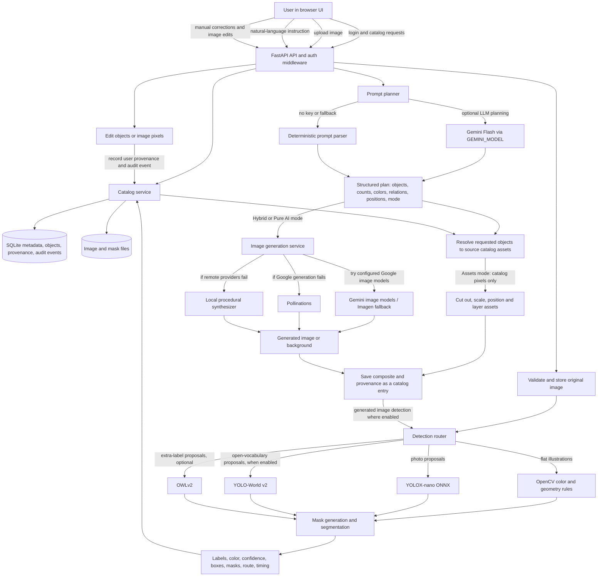

# Image Catalog

A local web application for **Image Catalog, Object Detection, Metadata, and Composite Image Generation**. It provides a reusable image catalog, automatic object detection, editable object metadata with provenance, and a composition workflow that can reuse existing catalog assets.

The central constraint is that the default **Assets** composition mode uses catalog pixels for requested objects. It reports missing assets instead of silently substituting generated lookalikes. Separate Hybrid and Pure AI modes are available when synthetic pixels are explicitly wanted.

## Project objectives

1. Store uploaded images and useful metadata in a searchable catalog.
2. Detect objects in both illustrated and photographic images, and store labels, colors, confidence, boxes, dimensions, and detection status.
3. Let a user correct missed or incorrect detections. Manual edits remain authoritative until detection is explicitly rerun.
4. Create a new composite catalog entry from a natural-language request and existing image assets, including layout, scaling, layering, and object metadata.
5. Demonstrate detection success and failure, manual correction, correction persistence, and asset-based composition with the supplied synthetic assignment images.

## Features

### Catalog and metadata

- Upload images or load the sample catalog generated for the assignment.
- Browse, search, preview, and inspect images and their detected objects.
- Store image dimensions, format, byte size, content hash, detection status, detector route, timing, dominant colors, timestamps, and provenance.
- Edit display name, description, and tags.
- Export per-image metadata as JSON.
- Move images and objects to Trash, restore them, or permanently purge them.

### Detection and review

- Use classical OpenCV color and geometry rules for flat illustrations, including the assignment's shapes, color swatches, fruit, and cartoon people.
- Use optional neural and open-vocabulary models for photographs and concepts outside the built-in rules.
- Display object masks, boxes, confidence, color, and provenance in the UI.
- Manually draw a missed object's box, add it to the catalog, edit an object's label/color/confidence/bounds, confirm a detection, delete or restore it, or revert an edit to the original automatic values.
- Explicitly rerun detection in either `preserve_manual` mode (refresh untouched automatic results while keeping user corrections) or `replace_all` mode (replace all current detections).

### Image editing

- Crop, resize, rotate, flip, and adjust image colors.
- Recolor, cut out, erase, or crop to a selected object.
- Blur the background or replace it with a solid color.
- Remove the background with the optional `rembg` U²-Net model; segmentation has local matte/GrabCut/box fallbacks.
- Edits normally create a new catalog entry; the UI also provides a replace option for supported operations.

### Composition and image generation

- **Assets:** parse a natural-language instruction, match requested objects against catalog detections/corrections, lay out the cut-outs, render a composite, and save it as a new catalog image with provenance and object boxes.
- **Hybrid:** combine catalog assets with generated scene/background content where supported by the planner and generator.
- **Pure AI:** generate a complete image from a prompt. The generated image is saved to the catalog and detection is run on it.
- Optional Gemini-assisted prompt planning can identify objects, counts, colors, positions, relationships, and generation mode. The deterministic parser remains available without a Gemini key.

## Architecture and end-to-end pipeline

The application is a local web app with a single-page browser UI, a FastAPI service layer, and a catalog service backed by SQLite metadata plus image and mask files on disk. API requests are scoped to the authenticated user. The detector, planner, image generator, and editing operations are separate modules called by the API and composition workflow.



### What happens in each pipeline

1. **Upload and cataloging:** The API validates an uploaded image, stores its original bytes, and creates metadata. A new upload normally starts detection automatically.
2. **Detection:** The router distinguishes flat backgrounds from complex backgrounds. Classical OpenCV rules are suited to clean illustrations; YOLOX-nano provides common object proposals for photos. YOLO-World adds text-prompted proposals when installed, and OWLv2 is an optional proposal source for explicit extra labels. Segmentation produces masks, while the catalog records labels, colors, confidence, boxes, detector route, and timing.
3. **Human review:** Users can draw or edit detections and update metadata. Each field tracks whether it came from the detector or the user. Re-detection is explicit: `preserve_manual` refreshes untouched automatic results and retains user work; `replace_all` intentionally replaces the current detections. Changes are recorded in the audit log.
4. **Prompt understanding:** The prompt planner extracts objects, quantities, colors, positions, and relationships into a structured plan. Gemini Flash can improve interpretation when configured; deterministic parsing is the fallback. Model selection is intended to come from `GEMINI_MODEL`; the code fallback is `gemini-2.5-flash`.
5. **Asset resolution and composition:** The resolver matches requested items against source-image detections and user corrections. Assets mode cuts out those catalog objects, scales and positions them, and saves the rendered composition as a new catalog entry with plan/provenance metadata. Missing required assets are reported rather than replaced with generated approximations.
6. **Optional generation modes:** Hybrid mode may use generated background or missing scene elements alongside catalog assets; Pure AI creates a complete image. These modes use a separate image-generation service, which tries Google image models first, then Pollinations, then a local procedural synthesizer. Generated results are saved to the catalog and detection is run on them.

**Architecture trade-offs:** Classical rules are quick and explainable on clean drawings, but do not generalize to every photo. Neural and open-vocabulary models broaden coverage but add latency, dependencies, and possible false detections. Gemini can interpret freer language but requires a working API key/model; the local parser is available as a fallback but is less flexible. Assets mode is predictable and preserves the assignment's existing-asset requirement; Hybrid and Pure AI are more flexible but synthesize pixels and may depend on remote services.

## Models and where they are used

| Model or method | Used for | Why it is included | Availability |
|---|---|---|---|
| Classical OpenCV rules | Flat illustrations and the provided assignment set | Color regions and shape geometry are predictable on clean drawings; results are fast, local, and explainable | Included in the base project; not a trained ML model |
| **YOLOX-nano** (COCO, 80 classes; ONNX) | Fast neural proposals and corroboration, mainly for photographs | Small model that runs through OpenCV DNN without PyTorch or a GPU; adds common real-world object classes | `models/yolox_nano.onnx` is included in this checkout; run `python scripts/fetch_assets.py` if it is missing |
| **YOLO-World v2** (default `yolov8s-worldv2.pt`) | Queried during normal detection when Ultralytics is installed; supplies open-vocabulary proposals alongside YOLOX on complex-background images | Text-promptable detector can search for concepts beyond COCO's fixed 80 classes; the UI reports when it was queried | Model file is present at the repository root. Requires `ultralytics`; can be disabled with `YOLOWORLD=off` or changed with `YOLOWORLD_MODEL`. First use may install Ultralytics' CLIP dependency and require an app restart |
| **OWLv2** (`google/owlv2-base-patch16-ensemble`) | Optional text-guided proposal source when extra labels are supplied, and in benchmarking | Offers a separate open-vocabulary detector implementation for user-supplied concepts | Optional; requires `torch` and `transformers`. Weights may be downloaded on first use or configured with `OPENVOCAB_MODEL`; disable with `OPENVOCAB=off` |
| **Gemini Flash** (selected with `GEMINI_MODEL`; code fallback `gemini-2.5-flash`) | Optional natural-language planning and interpretation | Turns freer instructions into a structured plan; the Assets resolver still validates every requested object against the catalog | Requires `google-genai` and `GEMINI_API_KEY` (or `GOOGLE_API_KEY`). Local parsing is used when unavailable |
| **Gemini image models** (`gemini-3.1-flash-image`, `gemini-2.5-flash-image`, `gemini-3-pro-image`; then Imagen 3 fallback) | Pure AI and supported hybrid generation | Creates new scene pixels when the user chooses a generation mode that allows them | Requires the Google GenAI SDK and a working API key/model entitlement |
| **Pollinations Flux** | Secondary image-generation fallback | Gives the generator another remote provider attempt if Google image generation fails | Uses network access; no local model installation |
| Local semantic raster synthesizer | Final image-generation fallback | Keeps the generation flow usable without a successful remote provider | Pillow/OpenCV procedural drawing; not equivalent to a general-purpose diffusion model |
| **rembg U²-Net** | Optional automatic foreground cut-out | Produces a foreground mask for background removal | Optional dependency; falls back to classical segmentation methods |
| GrabCut, Lab matte, and box masks | Segmentation fallback and object masks | Local methods provide usable masks when neural segmentation is absent or unsuitable | OpenCV-based fallback methods |

The benchmark evaluates the bundled synthetic ground-truth images. YOLO-World and OWLv2 receive a fixed generic vocabulary, not labels from the ground truth. A backend without its required dependencies/model is reported as unavailable; its zero metrics are not a performance measurement. The benchmark is not representative of general real-world accuracy.

## Project directory

```text
imgcatalog/
├── app/                       # Application and processing modules
│   ├── api.py                 # FastAPI routes and validation
│   ├── catalog.py             # SQLite/filesystem storage, metadata, corrections, audit log
│   ├── detector.py            # Detection routing and result merging
│   ├── neural.py              # YOLOX-nano ONNX/OpenCV DNN backend
│   ├── yoloworld.py           # Ultralytics YOLO-World backend
│   ├── openvocab.py           # Optional OWLv2 backend
│   ├── segmentation.py        # U²-Net, matte, GrabCut and box masks
│   ├── colors.py              # Color naming helpers
│   ├── imageops.py            # Image edits and background operations
│   ├── compose.py             # Prompt parsing, asset matching, layout and rendering
│   ├── planner.py             # Gemini planner and heuristic fallback
│   ├── generator.py           # Google, Pollinations and local image generation
│   └── evaluate.py            # Ground-truth evaluation and model benchmark
├── data/
│   ├── testset/               # Generated assignment images and ground_truth.json
│   └── store/                 # Runtime catalog database and image files (ignored by Git)
├── docs/                      # UI screenshots and documentation assets
├── examples/                  # Demonstration outputs and RESULTS.md
├── models/                    # Optional YOLOX ONNX weights
├── yolov8s-worldv2.pt          # YOLO-World v2 weights used by Ultralytics
├── scripts/
│   ├── make_testdata.py       # Generate assignment sample images and ground truth
│   ├── fetch_assets.py        # Download YOLOX-nano ONNX weights
│   ├── demo.py                # Generate example outputs
│   └── ui_smoke.py            # Browser smoke checks (Playwright)
├── static/
│   └── index.html             # Single-page web interface
├── tests/                     # Pytest coverage for API, catalog, detection, features, composition
├── weights/clip/               # Bundled ViT-B/32 checkpoint; not currently loaded by app modules
├── .env                       # Local secrets/configuration; ignored by Git
├── requirements.txt           # Base Python dependencies
├── requirements-openvocab.txt # Optional OWLv2 dependencies
└── test_model.py              # Standalone Gemini image-generation experiment
```

`data/store/`, `.env`, and generated Python caches are ignored by Git. The YOLO-World `.pt` file is separate from the optional YOLOX `.onnx` download.
`test_model.py` is an isolated, network-calling Gemini image-generation experiment (it writes `test_generated.png`); it is not part of the application startup flow.

## Installation and run

### Windows PowerShell

```powershell
py -3 -m venv .venv
.\.venv\Scripts\Activate.ps1
python -m pip install --upgrade pip
pip install -r requirements.txt
python scripts/make_testdata.py
python scripts/fetch_assets.py   # optional: YOLOX-nano for photographs
uvicorn app.api:app --host 127.0.0.1 --port 8000
```

Open <http://127.0.0.1:8000>, create an account with a username, name, and password, or sign in to an existing account. Each account has its own catalog; use **Sample data** to add the assignment images to that account. The local database and uploaded files are stored in `data/store/`.

### macOS or Linux

```bash
python3 -m venv .venv
source .venv/bin/activate
python -m pip install --upgrade pip
pip install -r requirements.txt
python scripts/make_testdata.py
python scripts/fetch_assets.py   # optional: YOLOX-nano for photographs
uvicorn app.api:app --host 127.0.0.1 --port 8000
```

### Optional model setup

YOLO-World is enabled when the `ultralytics` package and model weights are available. The repository includes `yolov8s-worldv2.pt`; install Ultralytics if it is not already present in your environment:

```bash
pip install ultralytics
```

OWLv2 can be added separately:

```bash
pip install -r requirements-openvocab.txt
```

Gemini planner and image generation use the Google GenAI SDK:

```bash
pip install google-genai
```

The standalone experiment can be invoked with `python test_model.py` after setting a valid Gemini key. It sends an image-generation request to Google and writes `test_generated.png` in the project root.

U²-Net cut-out can use `rembg` when installed:

```bash
pip install rembg
```

### API keys

For Gemini planning/image generation, set `GEMINI_API_KEY` or `GOOGLE_API_KEY` in the process environment, or put it in a local `.env` file. Example `.env` entry (replace the placeholder locally; never commit a real key):

```text
GEMINI_API_KEY=YOUR_KEY_HERE
```

The application does not provide an endpoint for writing or retrieving API keys. Catalog APIs require a signed-in account, and image collections and class colours are scoped to that account. This local development app does not include production deployment protections such as HTTPS termination, rate limiting, or account recovery; do not expose it directly to an untrusted network.

## Tests, demo, and benchmark

```bash
pytest
python -m app.evaluate
python scripts/demo.py
```

Optional browser smoke checks require Playwright and a browser installation:

```bash
pip install playwright
python -m playwright install chromium
python scripts/ui_smoke.py
```

The demo writes example images, metadata, and a summary under `examples/`. The test set is generated by `scripts/make_testdata.py`; if regenerated, inspect the resulting ground truth and outputs before comparing benchmark numbers.

## Detection and correction rules

New image uploads run detection by default. For flat art, the detector uses image color/geometry rules and can add YOLO-World proposals when available. For complex backgrounds, YOLOX-nano must be available for the neural route; YOLO-World is queried alongside it when installed, and proposals are segmented with GrabCut or fallback masks. OWLv2 can add proposals when extra labels are supplied and its optional dependencies are installed. Detection status distinguishes successful, low-confidence, no-object, and failed cases.

Each object's editable fields keep provenance (`auto` or `user`), and automatic values are retained for reverting. Manual additions and edits are not silently overwritten: the API requires a re-detection mode. `preserve_manual` updates untouched automatic detections; `replace_all` explicitly replaces the current set, including manual work.

## Limitations

- The assignment test images are synthetic and simpler than varied illustrations or photographs.
- YOLOX recognizes only its COCO classes. YOLO-World and OWLv2 results depend on their installed models and prompt vocabulary; complex-background neural detection also needs the YOLOX ONNX file.
- YOLO-World/OWLv2 weights, first-time model downloads, hardware, and network availability affect runtime.
- Boy/girl classification in stylized drawings is heuristic and should be reviewed.
- Segmentation and pixel edits can be rough on complex images.
- Pollinations and Google image generation need network access; the local synthesizer is a limited fallback.
- Accounts isolate catalogs on the local installation. There is no password reset or account recovery flow.
- This is a local development app, not a hardened public web service.
