# Results (generated by scripts/demo.py)

## 1. Successful detection

Blue box = detected automatically. Dashed = below the 0.60 confidence threshold, flagged for review.

### apple  
status **ok**, route `flat-background`, 278 ms, dominant colours ['red']

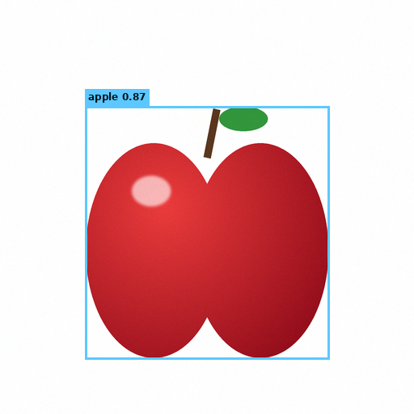

| object | colour | confidence | box (x, y, w, h) | origin | fields |
|---|---|---|---|---|---|
| apple | red | 0.87 | (105, 131, 302, 313) | auto | all auto |

### orange  
status **ok**, route `flat-background`, 138 ms, dominant colours ['orange']

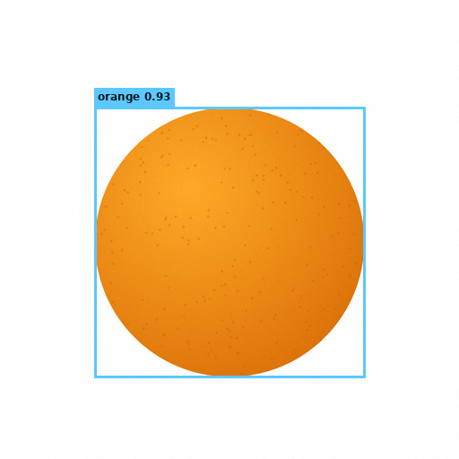

| object | colour | confidence | box (x, y, w, h) | origin | fields |
|---|---|---|---|---|---|
| orange | orange | 0.93 | (105, 119, 302, 302) | auto | all auto |

### boy  
status **low_confidence**, route `flat-background`, 148 ms, dominant colours ['blue', 'green', 'peach', 'brown']

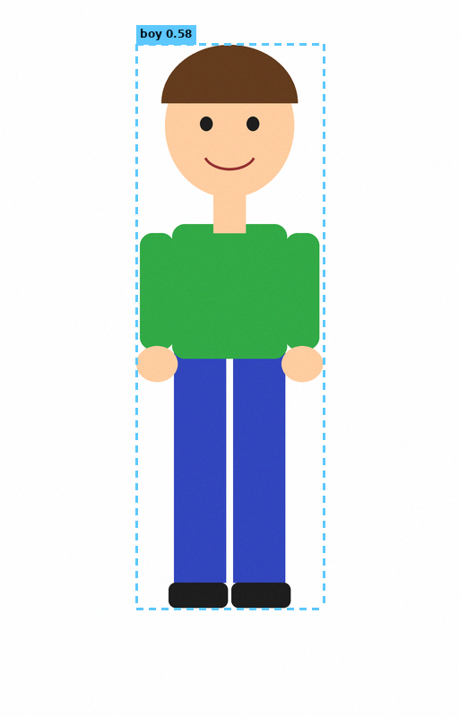

| object | colour | confidence | box (x, y, w, h) | origin | fields |
|---|---|---|---|---|---|
| boy | green/blue | 0.58 | (152, 49, 209, 630) | auto | all auto |

### girl  
status **low_confidence**, route `flat-background`, 141 ms, dominant colours ['purple', 'peach', 'pink', 'yellow']

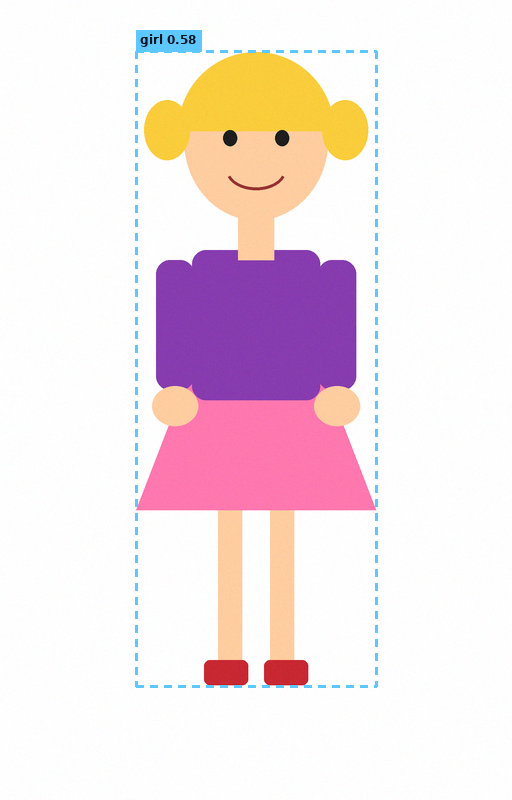

| object | colour | confidence | box (x, y, w, h) | origin | fields |
|---|---|---|---|---|---|
| girl | purple/pink | 0.58 | (136, 51, 240, 635) | auto | all auto |

### shapes  
status **ok**, route `flat-background`, 231 ms, dominant colours ['blue', 'yellow', 'red', 'green']

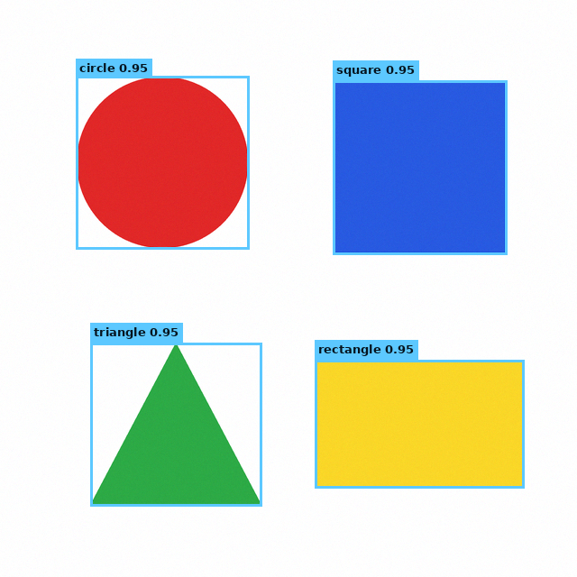

| object | colour | confidence | box (x, y, w, h) | origin | fields |
|---|---|---|---|---|---|
| circle | red | 0.95 | (84, 84, 192, 192) | auto | all auto |
| square | blue | 0.95 | (369, 89, 193, 193) | auto | all auto |
| triangle | green | 0.95 | (100, 380, 190, 181) | auto | all auto |
| rectangle | yellow | 0.95 | (349, 399, 232, 142) | auto | all auto |

### colors  
status **ok**, route `flat-background`, 215 ms, dominant colours ['green', 'red', 'yellow', 'purple']

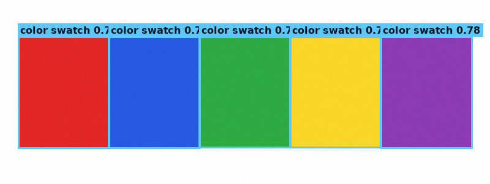

| object | colour | confidence | box (x, y, w, h) | origin | fields |
|---|---|---|---|---|---|
| color swatch | red | 0.78 | (29, 59, 149, 183) | auto | all auto |
| color swatch | blue | 0.78 | (177, 59, 149, 183) | auto | all auto |
| color swatch | green | 0.78 | (325, 59, 149, 182) | auto | all auto |
| color swatch | yellow | 0.78 | (473, 59, 149, 182) | auto | all auto |
| color swatch | purple | 0.78 | (621, 59, 150, 183) | auto | all auto |

### apple_orange  
status **ok**, route `flat-background`, 186 ms, dominant colours ['red', 'orange']

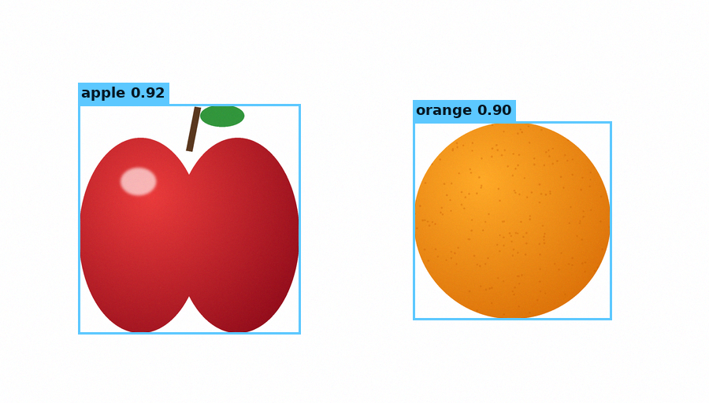

| object | colour | confidence | box (x, y, w, h) | origin | fields |
|---|---|---|---|---|---|
| apple | red | 0.92 | (99, 132, 282, 292) | auto | all auto |
| orange | orange | 0.90 | (524, 154, 252, 252) | auto | all auto |

### overlapping_shapes  
status **ok**, route `flat-background`, 236 ms, dominant colours ['red', 'blue', 'green']

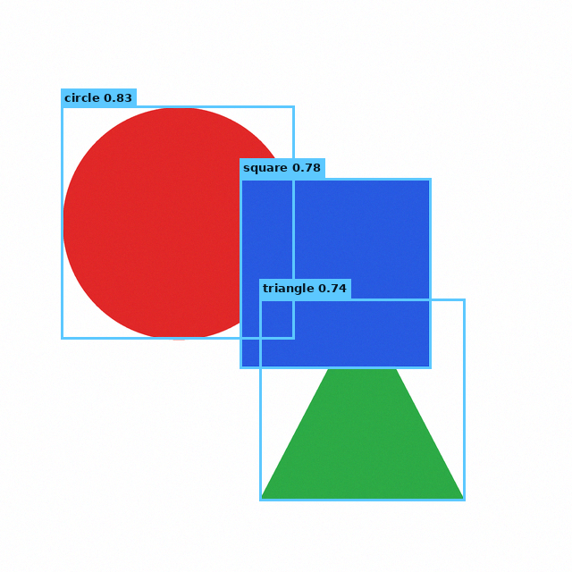

| object | colour | confidence | box (x, y, w, h) | origin | fields |
|---|---|---|---|---|---|
| circle | red | 0.83 | (68, 118, 261, 261) | auto | all auto |
| square | blue | 0.78 | (268, 199, 214, 213) | auto | all auto |
| triangle | green | 0.74 | (290, 334, 230, 226) | auto | all auto |

## 2. Failed detection

### blank (nothing to find)
status **no_objects** - Nothing stands out from the background (object may be too faint or absent).  
objects: 0

### low_contrast (a light-grey disc on white, below the contrast threshold)
status **no_objects** - Nothing stands out from the background (object may be too faint or absent).  
objects: 0

## 3. Manual correction (source of truth)

**Add** the missed object by hand:

| object | colour | confidence | box (x, y, w, h) | origin | fields |
|---|---|---|---|---|---|
| circle | light gray | 0.90 | (100, 100, 200, 200) | manual | label,confidence,bbox,color |

**Edit** name, confidence and box (fields now marked `user`):

| object | colour | confidence | box (x, y, w, h) | origin | fields |
|---|---|---|---|---|---|
| light gray disc | light gray | 0.95 | (96, 96, 208, 208) | manual | label,confidence,bbox,color |

**Persistence**: on `shapes` the triangle was renamed, the circle removed and a logo added. Re-running detection in *keep my corrections* mode:

| object | colour | confidence | box (x, y, w, h) | origin | fields |
|---|---|---|---|---|---|
| logo | black | 1.00 | (20, 20, 40, 40) | manual | label,confidence,bbox,color |
| circle (removed) | red | 0.95 | (84, 84, 192, 192) | auto | all auto |
| square | blue | 0.95 | (369, 89, 193, 193) | auto | all auto |
| green triangle | green | 0.70 | (100, 380, 190, 181) | auto | label,confidence |
| rectangle | yellow | 0.95 | (349, 399, 232, 142) | auto | all auto |

Corrections survived: ['green triangle', 'logo', 'rectangle', 'square']; the removed circle did not come back.

Only an explicit *replace everything* request discards them:

| object | colour | confidence | box (x, y, w, h) | origin | fields |
|---|---|---|---|---|---|
| circle | red | 0.95 | (84, 84, 192, 192) | auto | all auto |
| square | blue | 0.95 | (369, 89, 193, 193) | auto | all auto |
| triangle | green | 0.95 | (100, 380, 190, 181) | auto | all auto |
| rectangle | yellow | 0.95 | (349, 399, 232, 142) | auto | all auto |

## 4. Composite generation

### Create an image containing one red apple and one orange
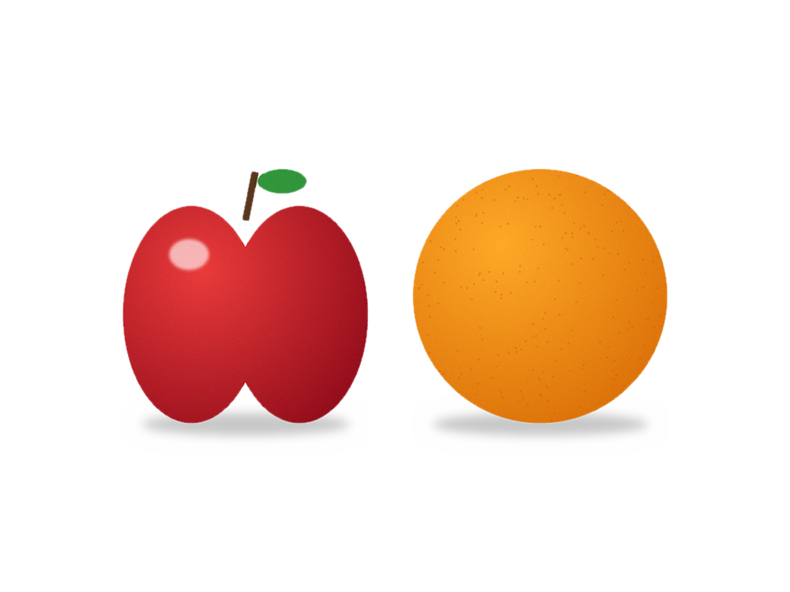

Saved as catalog entry `4bcce05ec3`; every object was pasted from an existing asset:

- apple (red) from **apple_orange**, scale 1.135, box [158, 218, 320, 332]
- orange (orange) from **orange**, scale 1.099, box [534, 218, 332, 332]

### Generate a composite containing a boy, a girl, and colored shapes
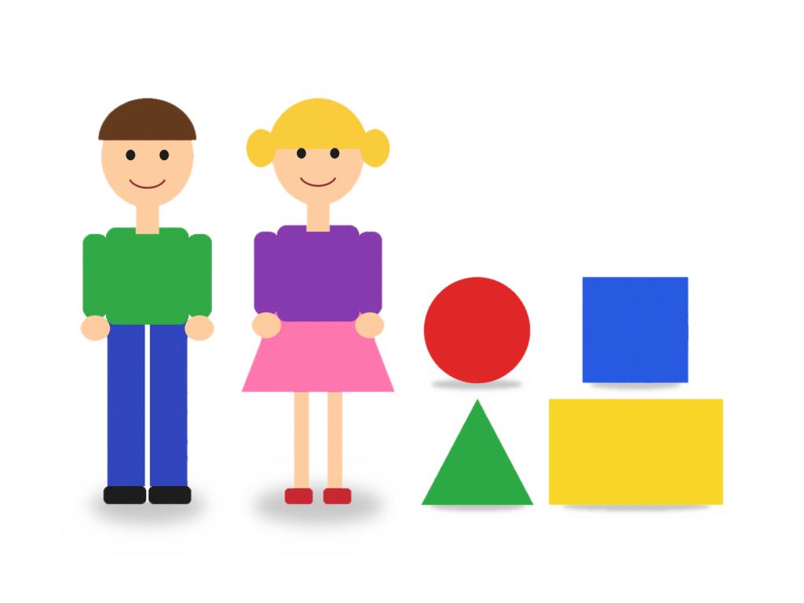

Saved as catalog entry `48a952f960`; every object was pasted from an existing asset:

- boy (green/blue) from **boy**, scale 0.823, box [102, 124, 172, 519]
- girl (purple/pink) from **girl**, scale 0.817, box [307, 124, 196, 519]
- circle (red) from **shapes**, scale 0.714, box [539, 352, 137, 137]
- square (blue) from **shapes**, scale 0.71, box [741, 352, 137, 137]
- triangle (green) from **shapes**, scale 0.758, box [536, 507, 144, 137]
- rectangle (yellow) from **shapes**, scale 0.966, box [698, 507, 224, 137]

### a small apple to the left of a large orange on a blue background
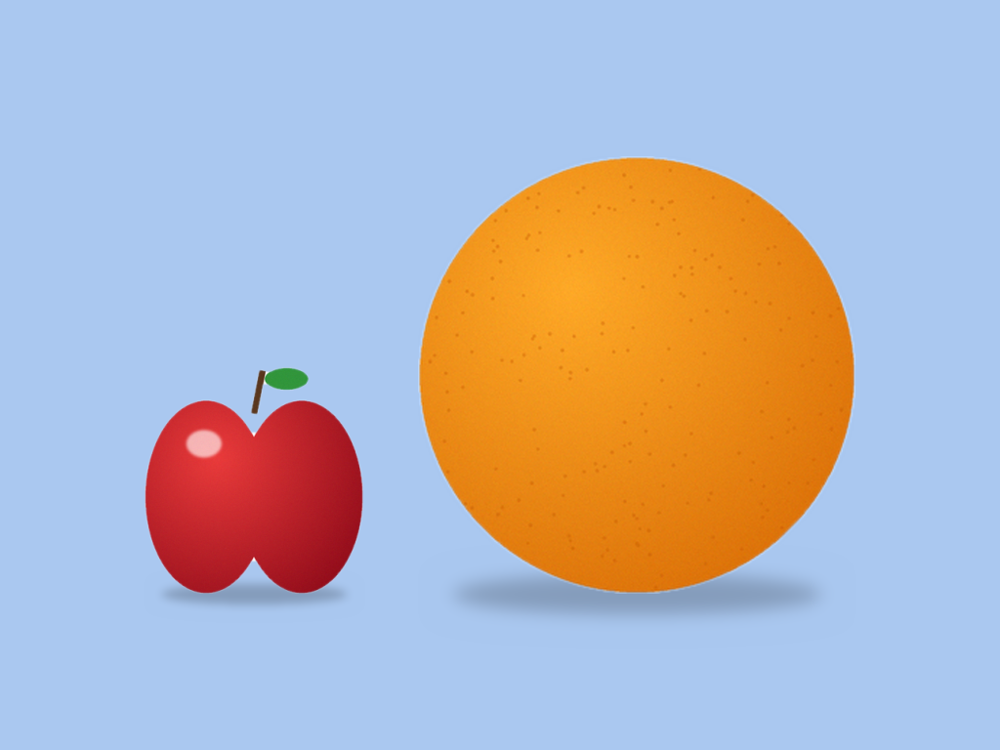

Saved as catalog entry `dffff7fdc7`; every object was pasted from an existing asset:

- apple (red) from **apple_orange**, scale 0.794, box [148, 376, 224, 232]
- orange (orange) from **orange**, scale 1.483, box [428, 160, 448, 448]

### a boy on the left, a girl on the right and shapes in the middle
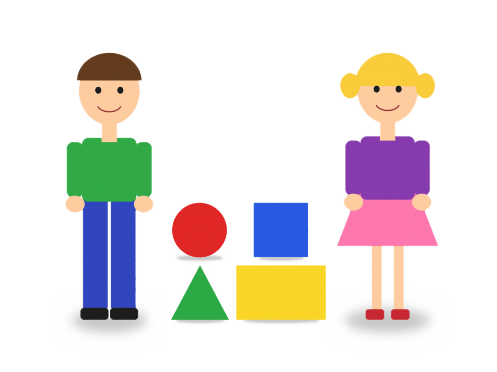

Saved as catalog entry `173eae8363`; every object was pasted from an existing asset:

- boy (green/blue) from **boy**, scale 0.876, box [134, 108, 183, 553]
- girl (purple/pink) from **girl**, scale 0.871, box [694, 108, 209, 553]
- circle (red) from **shapes**, scale 0.594, box [354, 418, 114, 114]
- square (blue) from **shapes**, scale 0.591, box [522, 418, 114, 114]
- triangle (green) from **shapes**, scale 0.632, box [352, 547, 120, 114]
- rectangle (yellow) from **shapes**, scale 0.802, box [486, 547, 186, 114]

### a red circle in front of a blue square
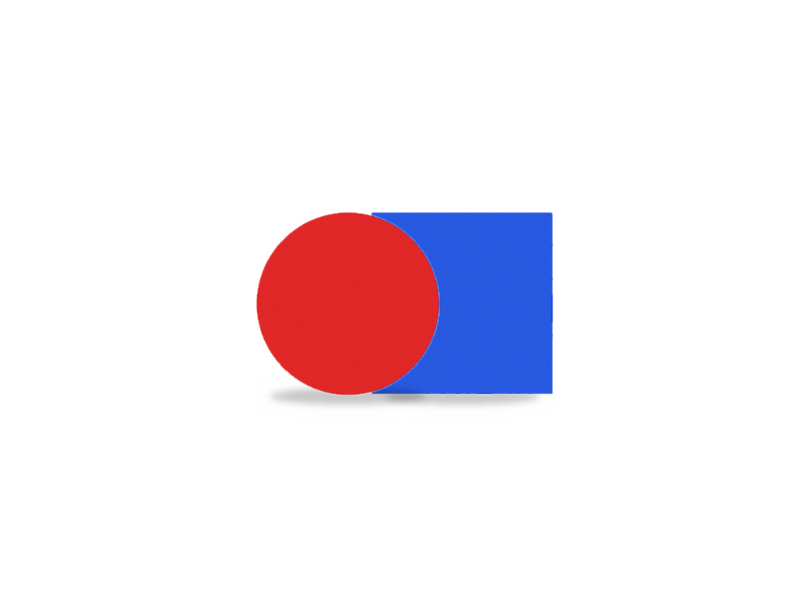

Saved as catalog entry `dacb2711bd`; every object was pasted from an existing asset:

- square (blue) from **shapes**, scale 1.207, box [468, 267, 233, 233]
- circle (red) from **shapes**, scale 1.214, box [323, 267, 233, 233]

### an orange above a red apple on a transparent background
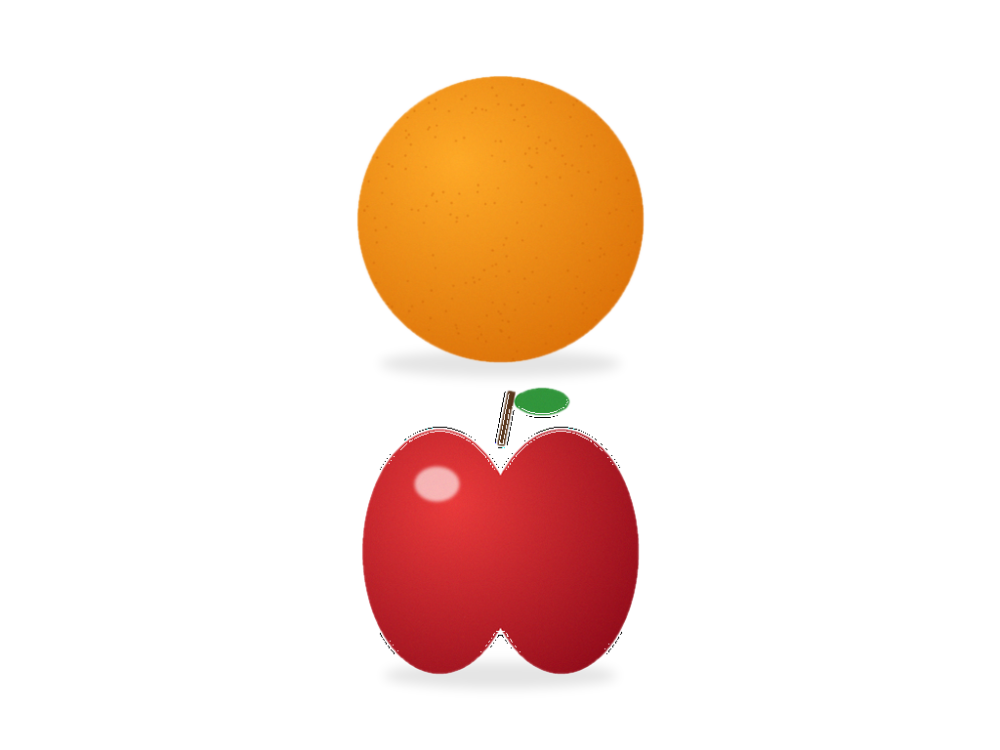

Saved as catalog entry `ae6b8b7315`; every object was pasted from an existing asset:

- orange (orange) from **orange**, scale 0.977, box [365, 77, 295, 295]
- apple (red) from **apple_orange**, scale 1.011, box [370, 396, 285, 295]

### Missing asset: refuses instead of approximating

`an apple, an orange and a banana` -> **refused**: ["'a banana': no catalog object labelled 'banana'"]. Catalog entries before/after: 16/16

`a blue apple` -> **refused**: ["'a blue apple': catalog has apple but not in blue (available: red)"]

## 5. Overlap and no-object cases

`overlapping_shapes`: the circle is half hidden behind the square and the triangle's apex is hidden, yet each box covers the whole shape.


| object | colour | confidence | box (x, y, w, h) | origin | fields |
|---|---|---|---|---|---|
| circle | red | 0.83 | (68, 118, 261, 261) | auto | all auto |
| square | blue | 0.78 | (268, 199, 214, 213) | auto | all auto |
| triangle | green | 0.74 | (290, 334, 230, 226) | auto | all auto |

`blank` and `low_contrast` return zero objects with an explicit status (section 2).

## Benchmark

```json
{
  "gt_objects": 19,
  "detections": 18,
  "matched": 18,
  "precision": 1.0,
  "recall": 0.947,
  "f1": 0.973,
  "label_accuracy": 1.0,
  "color_accuracy": 1.0,
  "mean_iou": 0.979
}
```

| image | status | ground truth | detected | label/colour correct | mean IoU |
|---|---|---|---|---|---|
| apple | ok | 1 | 1 | 1/1 | 0.987 |
| orange | ok | 1 | 1 | 1/1 | 0.987 |
| boy | low_confidence | 1 | 1 | 1/1 | 0.992 |
| girl | low_confidence | 1 | 1 | 1/1 | 0.997 |
| shapes | ok | 4 | 4 | 4/4 | 0.980 |
| colors | ok | 5 | 5 | 5/5 | 0.971 |
| apple_orange | ok | 2 | 2 | 2/2 | 0.985 |
| overlapping_shapes | ok | 3 | 3 | 3/3 | 0.972 |
| blank | no_objects | 0 | 0 | 0/0 | - |
| low_contrast | no_objects | 1 | 0 | 0/0 | - |

Real photographs (OpenCV sample images, YOLOX-nano route):

| file | expected | detected | confidence | status |
|---|---|---|---|---|
| apple.jpg | apple/red | apple/red | 0.59 | low_confidence |
| orange.jpg | orange/orange | orange/orange | 0.68 | ok |